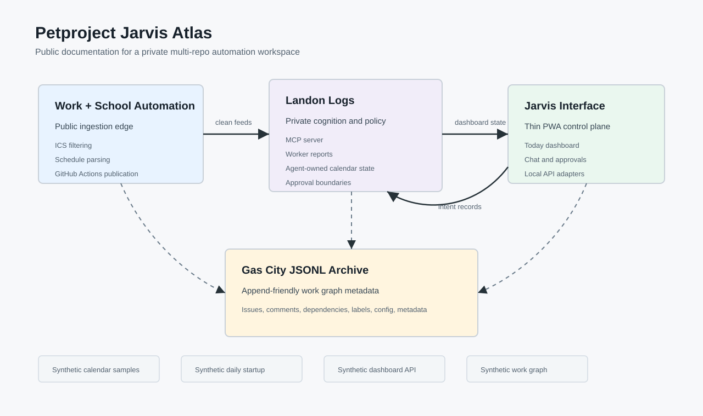

# Jarvis architecture atlas

Documentation and synthetic examples for one person's private cloud automation system. The ingestion and scheduling repositories are private. This atlas contains no credentials or production records.

The current system has two active responsibilities:

1. **work-school-automation-hub** receives a Canvas calendar and Power Automate work documents, validates them and publishes two clean ICS feeds plus one versioned manifest.
2. **Landon-Logs** combines those exact inputs with all current iCloud calendars and editable preferences. It schedules School study blocks first, then balances Personal gym and flexible Planner maintenance. A free-first intelligent review precedes journaled calendar reconciliation.

**API-Interface** is an intentionally dormant static PWA shell for possible later terminal/Tailscale hosting. It has no active personal-data API, dashboard, chat or action execution. This atlas is documentation, not another runtime service.

Start with [architecture](docs/architecture.md), [workflow walkthroughs](docs/workflows.md), [repository map](docs/repository-map.md) and [private boundaries](docs/public-boundaries.md). Exact operational instructions and editable rules live in the owning repositories.

The editable diagram source is [system-map.dot](assets/system-map.dot).
