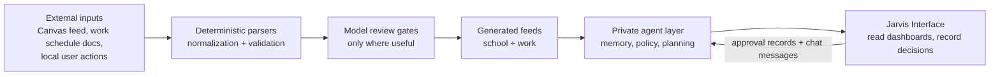

# System Architecture

The system is organized as a set of narrow layers. Each layer owns a clear part of the automation problem so private data and high-impact actions stay behind the right boundary.

## Layer 1: Public Ingestion Edge

`Work + School Automation` owns deterministic ingestion and publication for school and work calendar feeds.

- Parses Canvas-style ICS calendars.
- Filters announcement clutter and duplicate assignment variants.
- Parses work schedules from document-like inputs.
- Publishes normalized calendar feeds as generated artifacts.
- Uses model review only after deterministic parsing has produced a candidate result.

## Layer 2: Private Cognition And Policy

`Landon Logs` owns the private side of the system.

- Stores durable agent context, policies, proposals, and private planning state.
- Exposes a local stdio MCP server for supervisor sessions.
- Dispatches small worker tasks that write structured reports.
- Gates high-impact actions through policy and user approval.
- Owns the agent calendar and generated planning artifacts.

## Layer 3: Thin Interface

`Jarvis Interface` is the cross-device surface.

- Reads dashboard state through local adapters.
- Renders Today, chat, approvals, activity, device status, and finance snapshot views.
- Records local chat messages and approval decisions.
- Keeps secrets and linked financial tokens server-side.
- Does not become the authority for memory, scheduling, or external actions.

## Layer 4: Work Graph Archive

`Gas City JSONL Archive` keeps a compact JSONL view of local work graph state.

- Issues
- Comments
- Labels
- Dependencies
- Project metadata
- Configuration records

This archive makes the workspace auditable without requiring a database export in this public atlas.

## Boundary Model

## Design Principles

- Deterministic first: parsing and normalization happen before model review.
- Public/private split: feed generation can be public; personal policy and planning remain private.
- Synthetic examples: public samples demonstrate schemas without publishing real data.
- Thin UI: the interface shows state and captures intent, but execution authority remains in the private layer.
- Local control: private adapters read adjacent repos and local-only state from a trusted machine.

