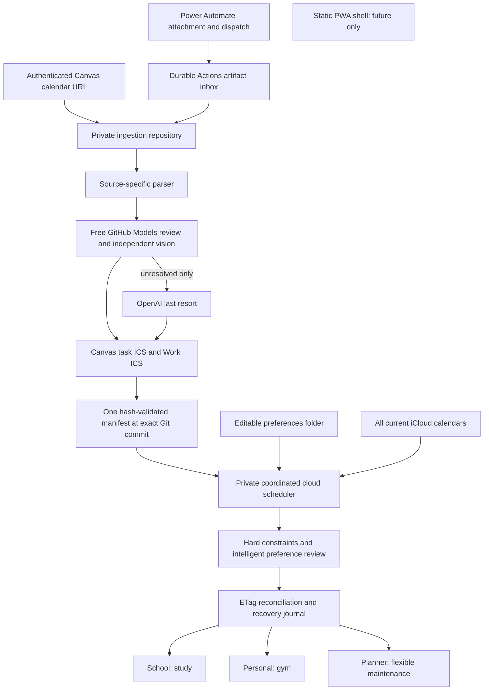

# Current architecture

The repositories exchange versioned files and a single repository dispatch. They do not require a database server, message broker, paid hosting platform or extra identity system. Existing Georgia Tech/Power Automate/GitHub/iCloud authentication is preserved. Tailscale remains the network boundary for a future locally hosted interface.

The scheduler owns only marked generated events in the active window. Human-created calendar events, subscriptions and legacy records are preserved. Appointments are a disabled future integration. Actual iCloud events define commitments, including Georgia Winterguard; no summer class timetable is hard-coded.
