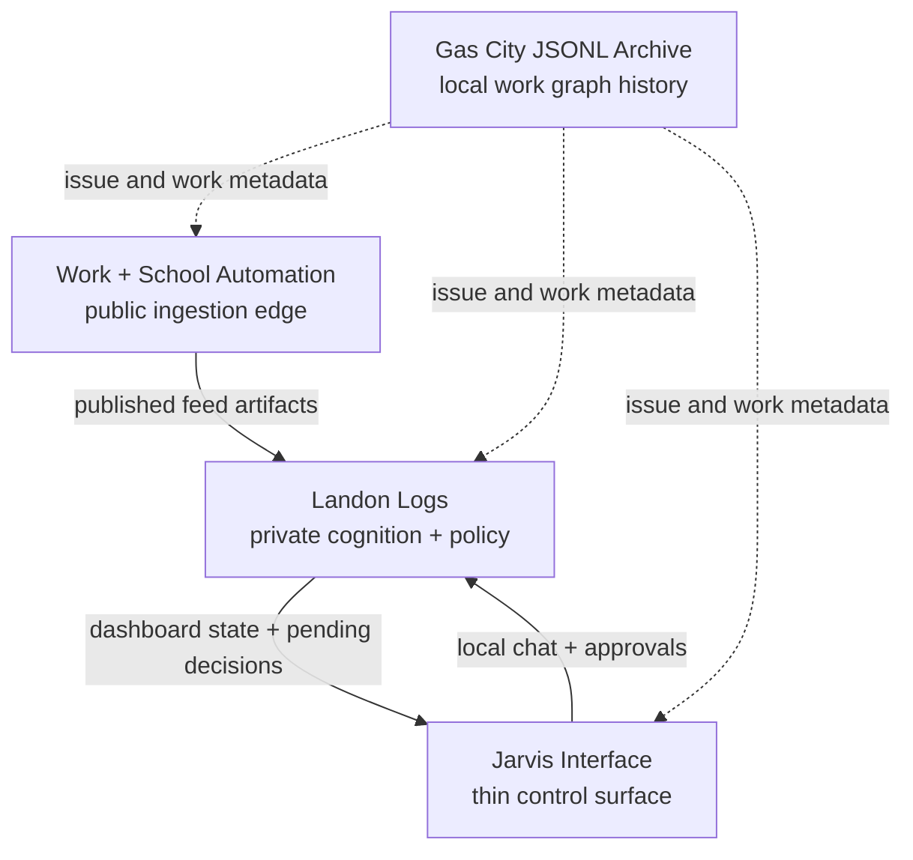

# Repository Map

This map is based on tracked Git metadata from the local workspace. It intentionally reports structure and scale rather than private remotes, production files, or exact commit messages.

## Inventory

| Project | Branch | Commits | Tracked Files | Primary Technologies |
| --- | ---: | ---: | ---: | --- |
| Work + School Automation | main | 80 | 34 | Python, ICS, GitHub Actions |
| Landon Logs | main | 48 | 111 | Python, MCP, JSON policy, Markdown knowledge surfaces |
| Gas City JSONL Archive | main | 6 | 28 | JSONL operational archive |
| Jarvis Interface | main | 4 | 30 | Node, JavaScript, PWA, CSS |

## Source Layers

## Per-Repo Notes

- [Work + School Automation](../repos/work-school-automation.md)
- [Landon Logs](../repos/landon-logs.md)
- [Jarvis Interface](../repos/jarvis-interface.md)
- [Gas City JSONL Archive](../repos/gas-city-jsonl-archive.md)

## File-Type Summary

| Project | File Mix |
| --- | --- |
| Work + School Automation | 7 Python files, 3 JSON files, 3 Markdown docs, 3 GitHub Actions YAML files, 2 ICS feeds, test coverage, and supporting Gas City metadata |
| Landon Logs | 57 JSON policy/state files, 23 Markdown knowledge docs, 7 Python modules/scripts, 5 JSONL logs, workflow configuration, and worker definitions |
| Gas City JSONL Archive | 28 JSONL files grouped by project key and record type |
| Jarvis Interface | 18 JavaScript modules, 4 Markdown docs, CSS/HTML/PWA assets, GitHub Actions, and local scripts |

## Worktree Scope

The atlas covers live Git roots under the workspace directory. One historical Work + School Automation worktree is registered outside the workspace and marked prunable by Git, so it is not treated as an active source for this atlas.

