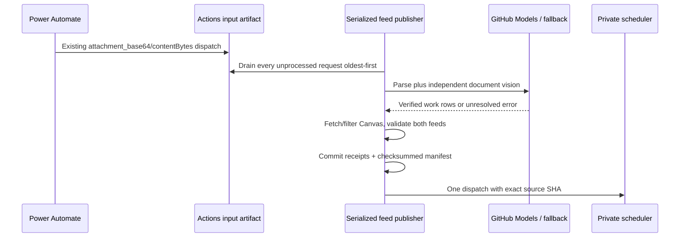

# Workflows and dependencies

## Feed publication

Input capture happens before the publisher concurrency group. Replacing a pending GitHub job therefore does not discard its input artifact. Failed requests remain available for retry. Daily catch-up recovers interrupted publication/dispatch. Artifacts have explicit retention; they are a bounded inbox, not a permanent archive.

Canvas output contains actionable school work. Deterministic informational exclusions and task patterns are documented in the feed repository; unknown titles require classification. Temporal filtering precedes cache reuse. Work parsing is tailored to the source table layout; independent GitHub vision sees the original rendered document without parser answers. OpenAI is optional and used only when free review fails or disagrees. An unresolved document preserves the existing feed.

## Scheduling

```mermaid
flowchart LR
  Inputs[Exact feed SHA and hashes] --> Health[Validate snapshot and work horizon]
  Health --> Availability[Discover and read every current calendar]
  Availability --> Study[Allocate school work first]
  Study --> Balance[Balance gym and long maintenance blocks]
  Balance --> Review[Required intelligent preference review]
  Review --> Refresh[Recheck availability]
  Refresh --> Write[Create/update before obsolete-event deletion]
  Write --> Verify[Verify remote state and save completion]
```

Failures never turn unavailable calendars into free time. A rejected/failed review cannot silently become a local approval. A partial reconciliation retains an operation journal; retry derives the remaining diff from observed remote state. No independent gym/study workflow competes for the same free time.
