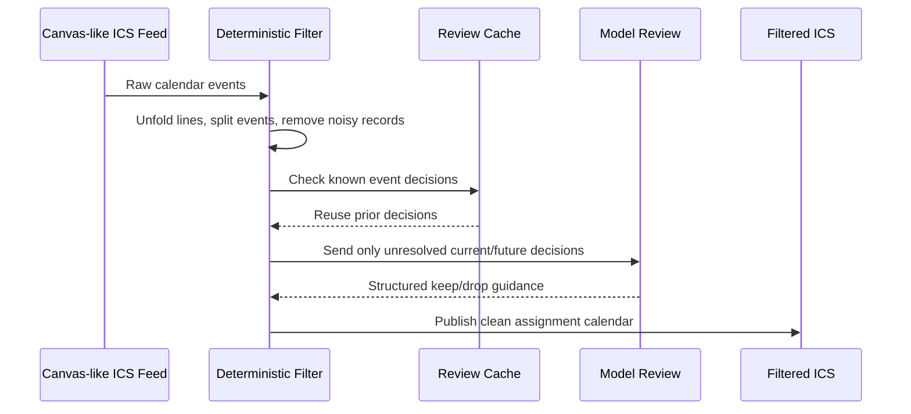
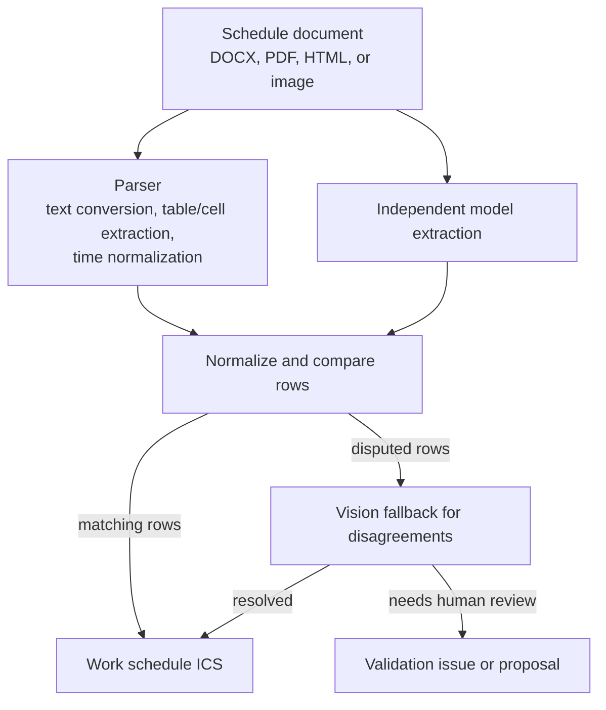
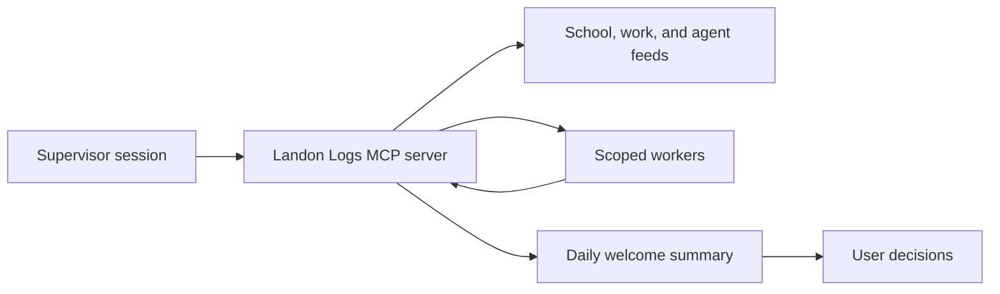
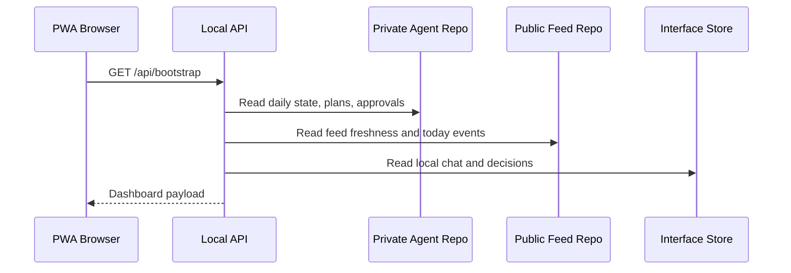

# Workflow Walkthroughs

## Canvas Calendar Filtering

See [synthetic raw calendar](../samples/canvas/raw-calendar.ics) and [synthetic filtered calendar](../samples/canvas/filtered-calendar.ics).

## Work Schedule Extraction

See [synthetic input rows](../samples/work-schedule/input-shifts.json) and [synthetic calendar output](../samples/work-schedule/work-schedule.ics).

## Daily Startup

See [synthetic daily startup payload](../samples/agent/daily-startup.json).

## Interface Bootstrap

See [synthetic bootstrap response](../samples/interface/bootstrap-response.json).

